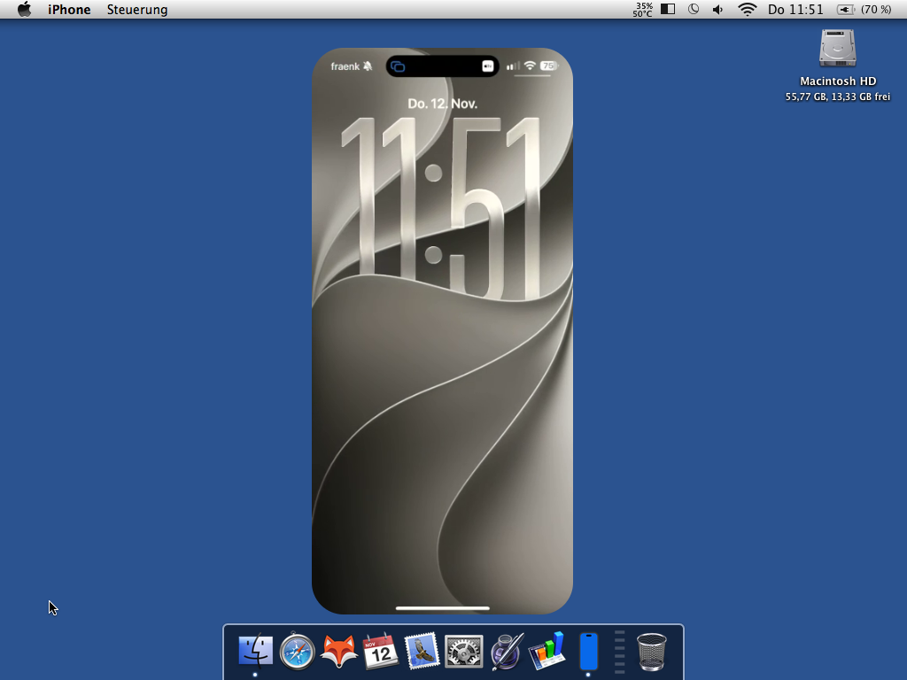

# iMirror G4

iPhone-Bildschirm in einem Fenster auf einem PowerPC-Mac mit Mac OS X 10.5 Leopard, bedienbar mit Maus,
Trackpad und Tastatur, über WLAN. So ähnlich wie die iPhone-Synchronisierung in macOS 15, nur auf einem iBook G4
aus dem Jahr 2004 und ohne Zusatzgerät.



Was geht:

- Bild per AirPlay-Bildschirmsynchronisierung, bis 40 Bilder/s, eigenes Fenster mit runden Ecken
- Klicken, Ziehen und Wischen mit der Maus, ohne Zeiger auf dem iPhone
- Zwei-Finger-Scrollen am Trackpad, iOS rollt selbst aus
- Zoomen mit zwei Fingern (⌥ + Scrollen)
- Tastatur (deutsche Belegung, Umlaute, ß, @)
- Home, App-Umschalter und iPhone-Suche (⌘1, ⌘2, ⌘Leertaste)
- gemeinsame Zwischenablage in beide Richtungen
- Dateien und Fotos vom iPhone herausziehen, Dateien und Ordner aufs Fenster ziehen
- Ton über die Lautsprecher des Macs, im Takt mit dem Bild; die Lautstärketasten des iPhones regeln ihn
- per Kabel oder WLAN, beim Abziehen des Kabels geht die Steuerung nach etwa 4 s über WLAN weiter

## Messwerte

Gemessen am 12.11.2026 mit:

| | |
|---|---|
| Mac | iBook G4 14" (PowerBook6,5), G4 mit 1,33 GHz, 1,25 GB RAM, ATI Radeon 9200, Bildschirm 1024 × 768 |
| System | Mac OS X 10.5.9 (Sorbet Leopard), Xcode 3.1.4, PowerVLC 2.1.0 (G4) |
| iPhone | iPhone 15 Pro Max, iOS 27.2 |
| Verbindung | WLAN im Heimnetz |

### Bild

| | |
|---|---|
| Bildstrom | 332 × 720 Bildpunkte, H.264, nur P-Bilder nach dem ersten Schlüsselbild, rund 4 KB je Bild |
| Bildrate | bis 40 Bilder/s |
| Scrolltest in den Einstellungen | bis 199 Bilder in 5 s angekommen, 98 % davon gezeigt |
| Dekodieren | 4–12 ms je Bild, am Mitschnitt im Mittel 7,08 ms (3353 Bilder) |
| AltiVec-Glättungsfilter | 7,30 → 7,08 ms je Bild (−3 %), Bild bitgleich |
| Umrechnung nach UYVY (AltiVec) | etwa 1,5 ms je Bild |

Warum 40: Mit 60 Bildern/s kam der G4 beim Scrollen nicht hinterher (11–15 ms Dekodieren je Bild, Rückstand bis
222 ms). Bei 50 schickte iOS nur etwa 35, weil 50 kein Teiler der 120 Hz des iPhones ist. Bei 40 kommen gleichmäßig 40.

### Verzögerung

Gemessen mit dem eingebauten Messmodus (siehe unten) in der Rechner-App, 20 Runden. Gezählt wird vom Absenden der
Eingabe an das iPhone, bis das geänderte Bild an die Grafikkarte geht.

| Eingabe | Median | Bereich |
|---|---|---|
| Taste (Ziffer erscheint) | 98 ms | 80–438 ms |
| Rücktaste | 98 ms | 83–107 ms |
| Finger auf eine Taste (Taste hellt auf) | 118 ms | 109–157 ms |
| Finger lösen (Taste löst aus) | 114 ms | 103–137 ms |
| Rücktaste direkt nach dem Fingertippen | 128 ms | 108–137 ms |

Die 438 ms waren ein einzelner Ausreißer, bei dem das Bild erst nach 425 ms am Mac ankam; die nächstlangsamste
Taste lag bei 113 ms.

Auf das iBook selbst (Ankunft bis gezeichnet) entfallen im Mittel 12,6 ms, höchstens 17,8 ms über 100 Messungen.
Der Rest liegt vor der Ankunft: Tunnel zum iPhone, iOS selbst, Aufnahme, Kodieren, WLAN.

Nicht enthalten sind der Weg von Taste oder Maus bis zum Ereignis im Fenster und der Bildaufbau des Bildschirms.
Zusammen dürften das noch einmal 15–30 ms sein.

Für Apples iPhone-Synchronisierung auf dem Mac gibt es keine veröffentlichte Messung der Verzögerung, deshalb steht
hier kein direkter Vergleich.

Die Zeitstempel, die das iPhone in den AirPlay-Strom schreibt, liegen etwa 85 ms nach der Ankunft am Mac. Sie sind
also ein Wiedergabetermin, keine Aufnahmezeit. Das Fenster wartet darauf nicht, sondern zeigt jedes Bild sofort.

### Ton

Das iPhone schickt den Ton als AAC-ELD (44,1 kHz, Stereo, 480 Samples je Paket) und jedes Paket dreimal, versetzt
mit den Nachbarn. Gemessen mit einem Video mit Ton, eine Minute:

| | |
|---|---|
| Pakete | 92 je Sekunde (nach dem Aussortieren der Kopien) |
| Dekodierfehler | 0 |
| Ton gegen Bild | 38–52 ms später als das Bild, Ziel 40 ms |
| Unterläufe (Knacken) | 0 in den 50 s nach dem Start |
| Lücken | 0–2 je 5 s; diese Pakete kommen beim Mac nie an |
| Ankunft vor dem Termin | 75–125 ms |
| Entschlüsseln und Dekodieren | 0,09 ms je Paket, unter 1 % des Prozessors |

Im WLAN selbst ging in einem Mitschnitt über 14,5 s kein Tonpaket verloren, keines kam in falscher Reihenfolge an.
Die Ankunft schwankt im Median um 11 ms, bei 99 % der Pakete um höchstens 29 ms, im Einzelfall um 60 ms.

Der Ton läuft absichtlich 40 ms hinter dem Bild. Ein nachlaufender Ton fällt erst ab etwa 100 ms auf, und die 40 ms
sind Reserve gegen Verzögerungen im WLAN. Ohne diese Reserve gab es etwa drei Aussetzer je Minute. Hängt das Bild
selbst für einen Moment, läuft der Ton weiter und ist kurz voraus.

In den ersten 10 s nach dem Verbinden, bevor das erste Synchronpaket des iPhones da ist, gab es noch Aussetzer. Der
Anfang hat seitdem einen größeren Puffer (120 statt 40 ms); das ist noch nicht nachgemessen.

### Last

| Programm | Prozessor beim Scrollen | Prozessor bei einem Video mit Ton | Speicher |
|---|---|---|---|
| Fenster (Spiegel) | 19–20 % | 47 % | 32 MB |
| Dienst (fernbedienung) | etwa 1 % | 7 % | 11 MB |
| Steuerung (geraet) | etwa 3 % | 3 % | 1 MB |

Bei einem Video mit Ton bleibt gut die Hälfte des Prozessors frei. Ein bewegtes Video ist für den Decoder mehr
Arbeit als eine Liste: 10–21 ms je Bild statt 4–12 ms.

Im WLAN: AirPlay rechnerisch etwa 1,3 Mbit/s bei 40 Bildern/s, Ton etwa 0,25 Mbit/s (dreifach gesendet entsprechend
mehr), dazu der Hilfsstrom der Entwicklerdienste, der auf 1 Mbit/s begrenzt ist.

## Aufbau

Drei Programme, alle in C oder Objective-C, gebaut mit gcc 4.2 aus Xcode 3.1:

**fernbedienung** läuft als LaunchAgent in der Benutzersitzung. Es meldet den Mac im Netz als AirPlay-Empfänger an,
mit einem eigenen kleinen Bonjour (mDNS) im Programm. Die Kopplung läuft über Legacy-Pairing (Ed25519, X25519),
der FairPlay-Austausch über playfair aus UxPlay. Den H.264-Strom entschlüsselt es (AES-CTR) und reicht ihn mit
Zeitstempel über eine Pipe an das Fenster weiter. Die Tonpakete gehen über eine zweite Pipe ans Fenster, jedes nur
einmal, dazu Schlüssel, Synchronpakete, Uhrabgleich und Lautstärke. Für den Uhrabgleich fragt es jede Sekunde die
Uhr des iPhones ab (NTP). Nebenbei ist es eine Apple-TV-Fernbedienung für den ganzen Mac (siehe unten).

**Spiegel.app** ist das Fenster. Zum Dekodieren dient das FFmpeg, das in PowerVLCs avcodec-Modul steckt. Das Modul
wird per dlopen geladen, die FFmpeg-Funktionen sucht das Fenster in dessen Symboltabelle. Drei
H.264-Glättungsfilter tauscht es gegen eigene AltiVec-Fassungen. Jedes Bild wird sofort gezeigt; nur wenn das
Fenster hinterherhängt und schon der nächste Rahmen wartet, lässt es eines aus. Die Farbumrechnung nach UYVY
läuft mit AltiVec, Skalierung, Farbraum und runde Ecken macht die Radeon (OpenGL, GL_YCBCR_422_APPLE, DMA aus dem
Hauptspeicher).

Den Ton entschlüsselt das Fenster (AES-128-CBC), bringt die Pakete in die richtige Reihenfolge und dekodiert sie
mit demselben FFmpeg. Gespielt wird über CoreAudio. Das iPhone gibt Bild und Ton einen gemeinsamen
Wiedergabetermin. Das Fenster zeigt Bilder früher als diesen Termin und misst laufend, um wie viel. Den Ton spielt
es um denselben Betrag früher, abzüglich der 40 ms Reserve. Kleine Abweichungen gleicht es aus, indem es einzelne
Samples auslässt oder doppelt, höchstens 6 von 512.

**geraet** bringt die Eingaben aufs iPhone, denn AirPlay überträgt keine. Es baut wie Xcode einen
CoreDevice-Tunnel zum iPhone auf: Lockdown-Kopplung, TLS, ein eigener IPv6/TCP-Stapel im Tunnel, darauf HTTP/2
und RemoteXPC. Über die HID-Dienste der Entwicklerwerkzeuge gehen Berührungen, Tasten und Systemtasten
(Home, App-Umschalter) ans iPhone, über den Zwischenablage-Dienst Texte, Bilder und Dateien. Mausbewegungen kommen
unregelmäßig an (alle 11–18 ms); geraet glättet sie auf gleichmäßige 120 Hz. Ein Klick ohne Bewegung geht ohne
diesen Puffer raus. Dafür braucht das iPhone den Entwicklermodus und das geladene Entwickler-Abbild.

Optional: **Trackpad.kext**, ein Treiber für das ADB-Trackpad des iBook G4, der Zwei-Finger-Scrollen nachrüstet
und dem Fenster meldet, wann Finger aufliegen. Damit rollt beim Wischen iOS selbst aus statt Leopard.

## Voraussetzungen

- Mac mit G4 (AltiVec) und Mac OS X 10.5. Getestet nur auf dem oben genannten iBook mit 10.5.9.
  Ein G3 reicht nicht.
- [Xcode 3.1.4](https://developer.apple.com/download/all/) (Anmeldung bei Apple nötig) für gcc 4.2 und das
  10.5-SDK.
- [PowerVLC 2.1.0 für G4](https://github.com/Olsro/powervlc/releases) (`powervlc-2.1.0-mac-g4.zip`), installiert als
  `/Applications/PowerVLC.app`. Das Fenster nutzt dessen libvlc und FFmpeg.
- Apples usbmuxd für das einmalige Koppeln per Kabel. Er kommt mit iTunes 10.6.3, dem letzten iTunes für PowerPC.
- iPhone mit iOS 26.4 oder neuer, getestet mit iOS 27.2. Ältere Versionen brauchen ein anderes
  Entwickler-Abbild, das `geraet ddi` nicht laden kann.
- Mac und iPhone im selben WLAN. Für `geraet ddi` muss der Mac ins Internet (Signaturanfrage bei Apple).
- Ein beliebiger Rechner mit Python 3 für `ddi_vorlage.py`.

## Nachbau

### 1. Quellen kopieren und bauen

Der Ordner `fernbedienung` gehört nach `~/tools/fernbedienung`; die Pfade sind fest eingebaut.

```sh
mkdir -p ~/tools
cp -R iMirror-G4/fernbedienung ~/tools/
cd ~/tools/fernbedienung
bash bauen.sh pruefen
bash bauen.sh
sh iphone/bauen.sh
```

Ohne Xcode: Unter Releases liegt `iMirror-G4-ppc.zip` mit den fertig gebauten Programmen (`fernbedienung`,
`Spiegel.app`, `Zeiger.app`, `iphone/geraet`, `trackpad/bau/Trackpad.kext`). Erst die Quellen nach
`~/tools/fernbedienung` kopieren, dann den Inhalt des ZIPs mit `ditto` darüberlegen. PowerVLC wird trotzdem
gebraucht.

`bauen.sh pruefen` rechnet die Testvektoren aus atv-core durch (OPACK, SRP, HKDF, Rahmenverschlüsselung), alle
müssen stimmen. `bauen.sh` baut den Dienst, `Spiegel.app` und `Zeiger.app`, `iphone/bauen.sh` baut `geraet`. Beim ersten
Bauen kopiert `spiegel_bauen.sh` die libvlc-Header aus PowerVLC nach `vlcinclude`.

### 2. Dienst einrichten

```sh
sed "s#/Users/BENUTZER#$HOME#" local.fernbedienung.plist > ~/Library/LaunchAgents/local.fernbedienung.plist
launchctl load ~/Library/LaunchAgents/local.fernbedienung.plist
```

Das im Terminal des Macs eingeben, nicht über SSH. Über SSH geht es so:

```sh
export LAUNCHD_SOCKET=$(ls -d /tmp/launchd-*)/sock
launchctl load -S Aqua ~/Library/LaunchAgents/local.fernbedienung.plist
```

Der Dienst startet ab jetzt bei jeder Anmeldung und schreibt nach `~/tools/fernbedienung/protokoll.txt`. Neu starten
mit `sh neustart.sh` (launchd startet ihn nach bis zu 30 s wieder).

Auf dem Testgerät ist der Bonjour-Dienst von Mac OS X abgeschaltet, das eigene mDNS im Programm übernimmt die
Anmeldung. Ob beides nebeneinander läuft, ist nicht getestet.

### 3. iPhone koppeln (einmal, per Kabel)

```sh
sudo launchctl load -F /System/Library/LaunchDaemons/com.apple.usbmuxd.plist
cd ~/tools/fernbedienung/iphone
./geraet koppeln
```

Auf dem iPhone „Vertrauen“ wählen und den Code eingeben. Die Kopplung landet in `iphone/paarung.plist`. Die Datei
enthält die Schlüssel für das iPhone und gehört niemandem sonst.

```sh
./geraet entwickler
```

Danach auf dem iPhone unter Einstellungen > Datenschutz & Sicherheit > Entwicklermodus einschalten, das iPhone
startet neu, danach bestätigen.

```sh
./geraet wlan
```

erlaubt die Verbindung über WLAN. usbmuxd wird nur fürs Kabel gebraucht und ist nach einem Neustart des Macs wieder
aus.

### 4. Entwickler-Abbild laden

Aus [doronz88/DeveloperDiskImage](https://github.com/doronz88/DeveloperDiskImage), Ordner
`PersonalizedImages/Xcode_iOS_DDI_Cryptex`, diese Dateien holen: `BuildManifest.plist`, `Image.dmg`,
`Image.dmg.trustcache`, `Image.dmg.cryptex_info`, `Image.dmg.root_hash`. Auf einem Rechner mit Python 3:

```sh
python3 ddi_vorlage.py <Ordner mit den Dateien> ddi_vorlage.plist
```

`ddi_vorlage.plist` und die vier Abbild-Dateien nach `~/tools/fernbedienung/iphone/ddi/` kopieren, dann auf dem Mac:

```sh
cd ~/tools/fernbedienung/iphone
./geraet ddi
```

`geraet` lässt das Abbild bei Apple für dieses iPhone signieren und überträgt es. Das hält bis zum nächsten
iOS-Update, danach mit dem passenden neuen Abbild wiederholen.

### 5. Trackpad-Treiber (optional)

Nur für das ADB-Trackpad im iBook G4. Apples Treiber bleibt geladen, dieser übernimmt nur den Empfang der Pakete.

```sh
cd iMirror-G4/trackpad
bash bauen.sh
bash laden.sh
```

`bauen.sh` prüft den Treiber nur (`kextload -t`), `laden.sh` kopiert ihn nach
`/Library/Application Support/iMirror-G4` und lädt ihn. Nach einem Neustart ist er wieder weg, bis er erneut geladen
wird. Zurück zu Apples Treiber: `sudo kextunload -b local.trackpad`. In den Systemeinstellungen unter Trackpad
erscheinen danach Apples Schalter für Zwei-Finger-Scrollen und Sekundärklick.

Ein Kernel-Treiber kann den Mac zum Absturz bringen. Vorher sichern.

## Benutzung

Auf dem iPhone im Kontrollzentrum Bildschirmsynchronisierung wählen, dann den Mac (er heißt wie in den
Systemeinstellungen unter Sharing). Das Fenster „iPhone“ öffnet sich, nach ein paar Sekunden ist auch die Steuerung
verbunden (`Steuerung bereit` im Protokoll).

| Am Mac | Am iPhone |
|---|---|
| Klicken, Ziehen | Tippen, Wischen |
| Zwei Finger am Trackpad | Scrollen |
| ⌥ + zwei Finger | Zoomen an der Mausposition |
| Tippen auf der Tastatur | Texteingabe |
| ⌘1 | Home |
| ⌘2 | App-Umschalter |
| ⌘Leertaste | Suche |
| Kopieren am Mac | landet in der Zwischenablage des iPhones |
| Kopieren am iPhone | landet in der Zwischenablage des Macs, Dateien als Vorschau in der Leiste zum Herausziehen |
| Datei oder Ordner aufs Fenster ziehen | wird an der Stelle eingesetzt (Ordner als ZIP) |
| Lautstärketasten am iPhone | Lautstärke des Tons auf dem Mac |

Über dem Fenster erscheint bei Mauskontakt eine Leiste: Schließen, Home, App-Umschalter, Vorschau des zuletzt
Kopierten. An der Leiste lässt sich das Fenster verschieben. Solange das Fenster vorn ist, ist ⌘Leertaste auf dem
Mac abgeschaltet und geht ans iPhone.

## Nebenbei: Apple-TV-Fernbedienung

Der Dienst ist auch eine Fernbedienung für den ganzen Mac. Im Kontrollzentrum des iPhones unter Fernbedienung den
Mac wählen, der Mac zeigt einen vierstelligen Code. Danach:

- Pfeile und Wischen: Pfeiltasten, Tippen: Return, Menü: Esc, TV-Taste: ⌘Tab
- Play/Pause: Leertaste, Lautstärke und Stumm: System, Ein/Aus: Bildschirm aus und an
- TV-Taste 0,8 s halten: Mausmodus (Wischen bewegt den Zeiger, Tippen klickt, am rechten Rand scrollen)
- Tastatur des iPhones tippt am Mac. Dafür muss in den Bedienungshilfen „Zugriff für Hilfsgeräte aktivieren“ an sein.

## Fehlersuche

- `protokoll.txt` zeigt alle 30 s, bei Problemen alle 5 s eine Zeile mit angekommenen, dekodierten und gezeigten
  Bildern, Dekodierzeit und Rückstand.
- `sh bild.sh` macht ein Bildschirmfoto nach `/tmp/bild.png`, auch über SSH. `sh log_auszug.sh` zeigt das Ende des
  Protokolls ohne die vielen Wischzeilen.
- Bild steht still: Synchronisierung am iPhone beenden und neu verbinden. Hilft das nicht, `sh neustart.sh`.
- Bild läuft, Klicks kommen nicht an: `./geraet ddi` muss „schon geladen“ melden, der Entwicklermodus muss an sein,
  und `./geraet wlan` muss einmal gelaufen sein.

## Messmodus

Das Fenster misst die Verzögerung selbst. Es schickt eine Eingabe, wartet auf das erste deutlich geänderte Bild und
notiert, wann es ankam, dekodiert und gezeichnet war. Gestartet wird eine Messung mit einer Datei
`/tmp/spiegel_messen`:

```
runden 20
Taste 7|k 24|k
Taste zurueck|k 2a|k
Finger ab|d 9550 47710
Finger auf|u 9550 47710
Taste zurueck 2|k 2a|k
```

Jede Zeile nach `runden` ist ein Schritt: Name, Befehl für `geraet`, und optional ein Befehl, der 60 ms später
folgt (hier: Taste loslassen). `k 24` drückt die HID-Taste 0x24 (7), `d x y` setzt einen Finger auf, `u x y` hebt
ihn ab. Die Koordinaten laufen von 0 bis 65535 über die Breite und Höhe des iPhone-Bildes. Die Werte oben passen
zur 7 in der Rechner-App im Hochformat.

Vor dem Start nachsehen, ob die richtige App vorn ist, sonst tippt die Messung woanders hin. `touch
/tmp/spiegel_messen_stopp` bricht eine laufende Messung ab. Das Ergebnis steht in `/tmp/spiegel_messung.txt` und im
Protokoll, mit Median, Mittel und Bereich je Schritt.

## Sicherheit

Nur im Heimnetz betreiben. Der Dienst nimmt im lokalen Netz AirPlay und die Fernbedienung an. Keine Portfreigaben
im Router einrichten. Steuern dürfen nur gekoppelte iPhones. `iphone/paarung.plist` und das Entwickler-Abbild
stehen in `.gitignore` und gehören nicht in ein Repo.

## Dateien

| Datei | Inhalt |
|---|---|
| `fernbedienung/fernbedienung.c` | Dienst: mDNS, Companion-Protokoll der Fernbedienung, Ablauf |
| `fernbedienung/airplay.c` | AirPlay-Empfänger: RTSP, Legacy-Pairing, FairPlay, Videostrom, Uhrabgleich |
| `fernbedienung/kopplung.c`, `opack.c`, `rti.m` | Kopplung (SRP, HKDF, ChaCha20), OPACK, Tastatur-Archive |
| `fernbedienung/eingabe.c`, `zeiger.m` | Tasten, Maus, Lautstärke, Bildschirm; runder Zeiger im Mausmodus |
| `fernbedienung/spiegel.m` | Fenster: Bild, Eingabe, Zwischenablage, Messmodus |
| `fernbedienung/dekoder.c`, `filter.c`, `uyvy.c` | H.264 und AAC über PowerVLCs FFmpeg, AltiVec-Filter, AltiVec-Farbumrechnung |
| `fernbedienung/ton.c` | Ton: Entschlüsseln, Reihenfolge, Dekodieren, CoreAudio, Gleichlauf mit dem Bild |
| `fernbedienung/tontest.c` | Tonweg an einem Mitschnitt prüfen (`/tmp/ton_proben` anlegen, dann verbinden) |
| `fernbedienung/iphone/geraet.c`, `tunnel.c`, `xpc.c` | Kopplung, Tunnel, RemoteXPC, Berührungen, Tasten, Zwischenablage, Entwickler-Abbild |
| `fernbedienung/iphone/ddi_vorlage.py` | Vorlage für die Signaturanfrage aus dem BuildManifest |
| `fernbedienung/playfair/` | FairPlay aus UxPlay, für Big Endian angepasst |
| `fernbedienung/pruefen.c`, `rti_pruefen.c` | Testvektoren für Kopplung und Tastatur-Archive |
| `fernbedienung/dektest.c`, `filtertest.c`, `zuspieler.c` | Dekodierzeit messen, Filter gegen FFmpeg prüfen, H.264-Datei ans Fenster spielen |
| `fernbedienung/gputest.m` | Probe für YUV-Umrechnung im Shader der Radeon 9200 (verworfen, Gründe im Kommentar) |
| `trackpad/` | Trackpad-Treiber |

## Herkunft und Lizenzen

Das Projekt steht unter der GPL-3.0 (`LICENSE.md`), weil es Code aus UxPlay enthält.

- `playfair/` und `fairplay_antworten.h` stammen aus [UxPlay](https://github.com/FDH2/UxPlay) (GPL-3.0),
  `playfair/` für PowerPC (Big Endian) angepasst.
- Monocypher 4.0.3 von Loup Vaillant, BSD-2-Clause oder CC0 (`monocypher-LICENCE.md`).
- `filter.c` enthält `h264_h_loop_filter_luma_altivec` aus FFmpeg 4.4.5 (LGPL-2.1 oder später), die anderen Filter
  sind neu geschrieben.
- `trackpad/Trackpad.cpp` ist eine geänderte Fassung von Apples AppleADBMouse-212 und steht unter der Apple Public
  Source License (Kopf der Datei). Die Änderungen sind im Kopf beschrieben.
- Protokolle nachgebaut nach [pymobiledevice3](https://github.com/doronz88/pymobiledevice3) (Tunnel, RemoteXPC,
  Entwickler-Abbild), [pyatv](https://github.com/postlund/pyatv) und atv-core (Fernbedienung) sowie UxPlay
  (AirPlay).
- PowerVLC, FFmpeg, iTunes, Xcode und das Entwickler-Abbild sind nicht enthalten und müssen aus ihren Quellen
  geholt werden.
